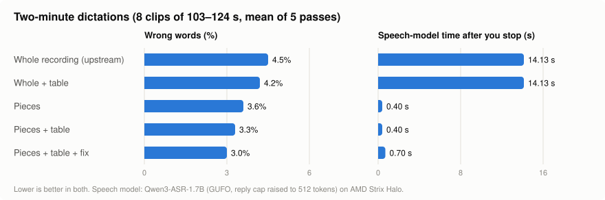
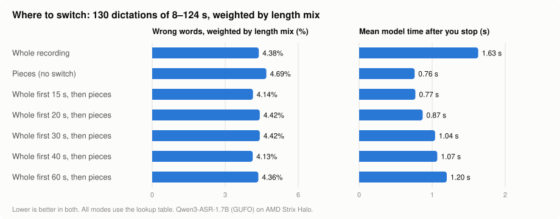
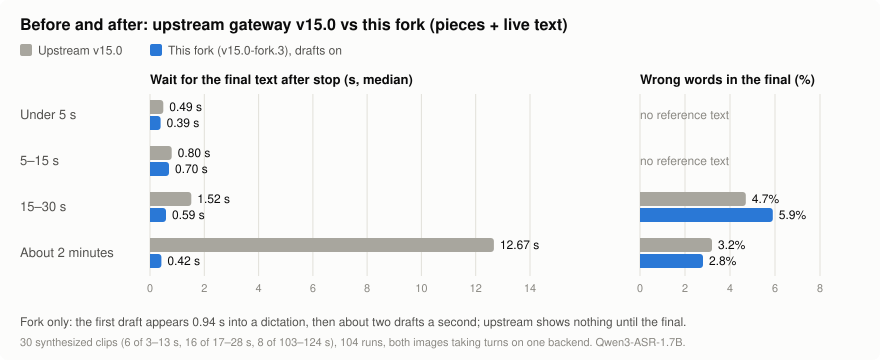

# Fork notes: faster final text on a self-hosted Diction gateway

Branch `live-text`, based on upstream `release/v15.0`. Not affiliated with DictionLabs. Changes and fixes: [FORK-CHANGELOG.md](FORK-CHANGELOG.md).

## What it adds

**Pieces mode** (`DICTION_SEGMENTED_FINAL=true`). Normally the gateway waits until the user
stops talking, then sends the whole recording to the speech model. In pieces mode it
transcribes during dictation: at each pause it sends the piece since the last pause, so after
"done" only the last piece is left. With `DICTION_SEGMENT_FIRST_MIN_MS` the first piece is
longer, so short dictations go whole and only long ones become pieces (15 s measured best).

```
whole    [ talk ................................ ] stop → [ transcribe everything ] → text
pieces   [ talk ...... | pause ...... | ........ ] stop → [ last piece ] → text
```

**Live text** (`DICTION_PREVIEW=chunked`): draft words during dictation, for clients that ask
(`?preview=cloud`). With it on, `/v1/models` advertises `"preview": true` in `capabilities`,
and `"preview_opus": true` when ffmpeg is present to decode Opus sessions; a client asks only
when it sees `preview`, and sends PCM unless `preview_opus` is also true. Diction for iOS asks
from 15.0.1; older versions read only the frame sent after "done" and are unaffected.

Both are off by default. If anything fails mid-way, the gateway sends the whole recording
exactly as upstream does, so a dictation is never lost.

## Pieces, live text and true streaming are three different things

| | Pieces | Live text | True streaming |
|---|---|---|---|
| What it changes | how soon the **final** text is ready | what the user **sees during dictation** | how the **model** listens |
| During dictation | nothing on screen | a draft about once a second, replaced each time | words appear as they are spoken |
| After stop | 0.4–0.8 s, any length | final as without drafts | almost nothing left to do |
| Needs client support | no | yes: the client must opt in and show drafts (Diction for iOS 15.0.1 and later) | yes, same as live text |
| Needs the model to stream | no | no | yes |

```
pieces      talk ...... | pause ...... | pause ....  stop → last piece → final
live text   talk ......................................  stop → final
            draft ↑ draft ↑ draft ↑ draft ↑ (each the whole transcript so far)
streaming   talk ......................................  stop → final
            word word word word word word word word ... (the model decodes as audio arrives)
```

They combine: drafts on screen during dictation, pieces for a fast final.

**Qwen3-ASR on GUFO does not stream input.** Tested with `fork/bench/rt_probe.py`, a
26 s clip played at real-time pace:

- `/v1/realtime` (OpenAI-style WebSocket) accepts audio but sends nothing until
  `input_audio_buffer.commit`. It then transcribes the whole buffer at once and streams the
  words out (first word 0.3 s after commit).
- Committing every 2 s gives a result 0.2–0.3 s after each commit, but each commit is a
  separate item heard without context: 2–8 words each, cut wherever the 2 s lands. That is
  pieces with blind cuts, worse than cutting at pauses.
- SSE (`stream=true` on `/v1/audio/transcriptions`) streams the text out quickly, but only
  after the whole file is uploaded.

So on this model, live text means re-transcribing the open piece (since the last pause) about
once a second, which the built-in preview (`DICTION_PREVIEW=chunked`) does: first words at
1.1–1.4 s in the bench. Word-by-word streaming needs a streaming-native model for the drafts,
with Qwen3-ASR kept for the final. The preview accepts PCM and Opus sessions (Opus is decoded
as it arrives).

## Short dictations: pieces are 3× faster but make nearly twice the errors

16 synthetic dictations of 17–28 s, dense with technical terms, 5 passes each, upstream and
fork taking turns (details below):

```mermaid
xychart-beta
    title "Whole recording vs pieces (16 clips, mean of 5 passes)"
    x-axis ["Wrong words (%)", "Wait after stop (s)"]
    y-axis 0 --> 11
    bar [5.7, 2.66]
    bar [10.2, 0.86]
```



| | Wrong words | Wait after stop |
|---|---|---|
| Whole recording (upstream) | **5.7%** | 2.66 s |
| Pieces (8 s minimum) | **10.2%** | **0.86 s** |

Pieces were worse on 10 of 16 clips, better on 1, the same on 5. Each piece is transcribed
without the words around it, and the model needs that context for rare words (names and
technical terms above all). Longer pieces (12 s, 16 s) did not fix it, and on a short piece
the model sometimes wrote out its whole hint list (the gateway now rejects a piece with more
text than its audio could hold).

**For short dictations, the whole recording is the more accurate mode.** Two-minute dictations
are the opposite case (see below): there pieces are both faster and more accurate.

## Lookup tables and a confidence fix

Two add-ons, tested on the same 16 dictations × 5 passes, every combination:

- **Lookup table**, applied to the text after transcription. A word that is neither English
  nor a known term is replaced by the closest term, by spelling and by sound, when the match
  is close and unambiguous. Three sizes: the 50-term hint list; a 268-term library; and the
  library plus 26 "heard → written" rules learned automatically from 16 *separate* training
  dictations (different sentences, different voices), so the rules were never tuned on the
  test.
- **Confidence fix.** The draft from the pieces marks low-confidence words: neither English
  nor a known term (the speech model reports no per-word confidence). Each piece holding one is
  re-transcribed with the piece before and after it as context, and only the uncertain words are
  swapped for what the wider window heard. Earlier pieces are fixed during dictation; only the
  last two pieces wait until stop.

| Mode | Wrong words | Terms spelled right | Model time after stop |
|---|---|---|---|
| Whole recording (upstream) | 5.7% | 79% | 1.27 s |
| Whole recording + best table | **5.4%** | 84% | 1.27 s |
| Pieces | 10.1% | 72% | **0.36 s** |
| Pieces + 50-term table | 9.5% | 76% | 0.36 s |
| Pieces + 268-term table | 9.0% | 80% | 0.36 s |
| Pieces + 268 terms + learned rules | 8.6% | 81% | 0.36 s |
| Pieces + confidence fix | 6.5% | 81% | 1.51 s |
| Pieces + 50-term table + confidence fix | 6.2% | 83% | 1.51 s |
| Pieces + 268-term table + confidence fix | 6.2% | **85%** | 1.38 s |
| Pieces + 268 terms + learned rules + confidence fix | 6.2% | **85%** | 1.29 s |

What this shows:

- **Tables alone help, but not enough:** 10.1% → 8.6% wrong words, at no cost in time (under
  2 ms; the table is indexed, so even 5,000 terms stay fast). The terms need to be real: a table
  padded with look-alikes makes pointless swaps.
- **The confidence fix closes most of the gap:** 6.2% wrong words, against 5.7% for the whole
  recording, and the best term spelling of any mode (85%). It improved 155 clip-passes and made
  20 worse (out of 320).
- **But on these short dictations it is not faster than the whole recording.** With 17–28 s
  clips there are only 2–3 pieces, so the window re-checked after stop is most of the
  recording. On longer dictations the picture flips: see the next section.
- **Learned rules must be curated.** Raw learning also proposed rules that map ordinary
  English phrases to terms; the learner now rejects any rule whose heard words are all
  ordinary English.

"Model time" is the speech model's own time, measured in one session for all modes. The
end-to-end wait adds network and gateway overhead and grows when the GPU is shared (the bench
above measured 0.86 s for pieces and 2.66 s for the whole recording under load).

Tools: `fork/bench/fuzzyfix.py` (table), `learn_rules.py`, `sim_repair.py` (the matrix
above).

## Two-minute dictations: pieces win on speed and accuracy

The whole-recording wait grows faster than the recording, so the same test was repeated on 8
synthetic dictations of 103–124 s each (mixed technical and everyday content; one has a 30 s
run with no real pause, to force the 20 s maximum cut), 5 passes each.



| Mode | Wrong words | Terms spelled right | Model time after stop | End-to-end wait (median) |
|---|---|---|---|---|
| Whole recording (upstream) | 4.5% | 70% | 14.1 s | 14.2 s |
| Whole recording + best table | 4.2% | 72% | 14.1 s | |
| Pieces | 3.6% | 73% | **0.40 s** | **0.40 s** |
| Pieces + 50-term table | 3.4% | 76% | 0.40 s | |
| Pieces + 268-term table (± learned rules) | 3.3% | 78% | 0.40 s | |
| Pieces + confidence fix | 3.0% | **80%** | 0.70 s | |
| Pieces + 50-term table + confidence fix | **2.9%** | **80%** | 0.70 s | |
| Pieces + 268-term table + confidence fix | 3.0% | 79% | 0.70 s | |

- **Pieces are 35× faster** (0.4 s against 14 s, end to end, median of 40 dictations each;
  pieces' slowest was 3.8 s, the whole recording's fastest 13.3 s).
- **And more accurate, not less**: 3.6% wrong words against 4.5%. Pieces were better on 4 of 8
  clips, the same on 3, worse on 1. On a long recording the model drifts; on 8–20 s pieces it
  stays on track. This is the opposite of the short-dictation result, where pieces lose the
  context they need.
- **The table helps a little at no cost** (3.6% → 3.3%), the confidence fix a little more
  (→ 2.9–3.0%, terms 73% → 80%) for 0.3 s. Every pieces variant beats the whole recording.
- Caveat: the confidence fix's model time assumes the re-checks of earlier pieces (about 3 per
  dictation, ~60 s windows) finish during dictation. On a single GPU they queue behind the
  pieces themselves; that is not modelled. Pieces alone and pieces + table were measured end
  to end.

**The speech model was cutting long dictations short.** GUFO caps each transcription reply
at about 256 tokens unless the request asks for more. Every two-minute whole recording came back
cut mid-sentence after 174–225 of 230–297 words (27% "wrong words", nearly all of it missing
text); pieces never hit the cap. Asking for `max_tokens=512` (GUFO's maximum) returns the whole
text for about 2 s more model time; the whole-recording numbers above are with that fix. 512
tokens is roughly 3 minutes of speech, so a longer whole recording is still cut; pieces are not.
The gateway used here sets `max_tokens` on every transcription request.

## Where to switch: whole for the first 15 s, then pieces

Short dictations are more accurate whole, long ones are faster and more accurate in pieces.
So the gateway can make the **first piece at least T seconds long**
(`DICTION_SEGMENT_FIRST_MIN_MS`): a dictation shorter than T goes whole, a longer one becomes
pieces after T. Which T?

**Test.** All 24 test dictations (16 short, 8 two-minute) were also cut short at each natural
pause, giving 130 dictations of 8–124 s. Each was transcribed whole, as plain pieces, and with
T = 15, 20, 25, 30, 40 and 60 s; every mode through the lookup table. Cuts come from a Python
port of the gateway's pause detector, which reproduces the gateway's logged cuts to 0.01 s. The
results are weighted to a length mix of 64% under 15 s, 15% 15–25 s, 12% 25–40 s and 8% longer
(mostly short dictations, with a long tail).



| Length | Whole | Pieces (no switch) | Whole first 15 s | Whole first 20 s |
|---|---|---|---|---|
| 15–25 s (27 dictations) | 5.3% · 1.53 s | 6.5% · 0.78 s | 6.0% · 0.82 s | 5.2% · 1.43 s |
| 25–40 s (17) | 5.2% · 2.11 s | 6.3% · 0.66 s | **4.7% · 0.72 s** | 5.7% · 0.74 s |
| 40–60 s (15) | 3.3% · 4.64 s | 3.3% · 0.81 s | **2.9% · 0.73 s** | 3.7% · 0.85 s |
| 60–90 s (22) | 3.7% · 7.82 s | 3.4% · 0.80 s | **3.1% · 0.84 s** | 3.6% · 0.82 s |
| 90–130 s (28) | 4.4% · 14.5 s | 3.6% · 0.60 s | **3.2% · 0.60 s** | 3.6% · 0.60 s |

(wrong words · speech-model time after stop; under 15 s every mode is the whole recording)

**The arithmetic.**

- *Speed.* The whole-recording wait fits `0.67 + 0.017·L + 0.00103·L²` seconds for L seconds of
  speech: it passes 1 s at about 12 s of speech and 2 s at about 29 s, and keeps growing with
  the square of the length. Pieces stay at 0.6–0.8 s whatever the length.
- *Accuracy.* Plain pieces cost `3.89 − 0.99·ln(L)` wrong-word points against the whole
  recording: +1.2 points at 15 s, +0.5 at 30 s, zero at **about 51 s** (80% interval 29–95 s,
  bootstrap over clips). The cost comes from a short first piece that the model hears without
  context.
- *A 15 s first piece removes most of that cost.* Over this length mix, whole-first-15-s makes
  **4.14%** wrong words against 4.38% for the whole recording and 4.69% for plain pieces, with
  a mean wait of **0.77 s** (whole: 1.63 s; worst length band 0.84 s against 14.5 s). It is the
  most accurate and nearly the fastest option, so no trade-off weight is needed: every later
  switch point is slower and no more accurate (T = 40 s ties on accuracy at 1.07 s).
- The differences in accuracy are small and the intervals are wide: 15 s vs whole is −0.8
  points (90% interval −1.6 to +0.2). On the 16 short, term-dense dictations alone, 15 s is
  still 1.1 points worse than whole (20 s: 0.5 worse, not significant), because a 17–28 s
  dictation leaves a short last piece. The speed gain is consistent across all lengths.

**Best measured: 15 s**, with the lookup table and `max_tokens=512`. In a real-time check the
two-minute dictations came back in 0.4–0.6 s with the full text, a 26 s one in 0.75 s, a 19 s
one (whole) in 1.3 s. Note: the minimum is checked when the pause qualifies and the cut goes in
the middle of the pause, so the first cut can land a few tenths of a second before T (the
simulation does the same).

Tools: `fork/bench/sim_switch.py` (sweep), `analyze_switch.py` (bands, fits, length-mix
weighting).

## Settings (environment variables, all off by default)

| Variable | Default | Meaning |
|---|---|---|
| `DICTION_SEGMENTED_FINAL` | `false` | Pieces mode. |
| `DICTION_PREVIEW` | `off` | `chunked` turns on live text for clients that ask, and advertises it on `/v1/models`. |
| `DICTION_SEGMENT_PAUSE_MS` / `_MIN_MS` / `_MAX_MS` | 700 / 8000 / 20000 | Where pieces are cut. |
| `DICTION_SEGMENT_FIRST_MIN_MS` | `0` (= `_MIN_MS`) | First piece at least this long: shorter dictations go whole. 15000 measured best. |
| `DICTION_PREVIEW_URL` / `_MODEL` | session backend | Optional faster backend for live text. |
| `DICTION_PREVIEW_INTERVAL_MS` | `1000` | New audio needed before the next draft (minimum 250). One draft runs at a time, so the backend's own speed is the floor. |
| `DICTION_DEBUG_STREAM` | `false` | Log timings per dictation (never audio, text or keys). |

## Build and run

Tag `v15.0-fork.3` marks a fixed version of the code described here. Build the gateway image
from the `gateway/` folder. Set `VERSION` to the upstream release: the app compares it with its own
version, and the default `dev` is treated as an untagged build.

```sh
git clone -b v15.0-fork.3 https://github.com/testyfishy/Diction.git
docker build --build-arg VERSION=v15.0 -t diction-gateway:fork Diction/gateway
```

To run it, follow the upstream setup in [README.md](README.md) and replace the gateway image
with `diction-gateway:fork`. Then add the settings for the mode under test. The tested
configuration was:

```yaml
    environment:
      DICTION_SEGMENTED_FINAL: "true"
      DICTION_SEGMENT_FIRST_MIN_MS: "15000"
      DICTION_PREVIEW: "chunked"        # live text, for clients that ask
      DICTION_PREVIEW_INTERVAL_MS: "250" # drafts as fast as the backend answers
      DICTION_DEBUG_STREAM: "true"      # per-dictation timings in the log
```

With every setting left off, the fork behaves like upstream `release/v15.0`.

## Live text and pieces together: verification

Tag `v15.0-fork.3`, settings as in [Build and run](#build-and-run), drafts sent straight to
the speech model (`DICTION_PREVIEW_URL`). One gateway played each clip as a client that does
not ask for live text ("off") and as one that does ("drafts"), taking turns: 6 clips of
3–13 s and 16 of 17–28 s in two passes, and 8 clips of 103–124 s in one pass (104 runs).

| Length | Runs per client | Final wait, off | Final wait, drafts | First draft | Drafts per second | Wrong words, off | Wrong words, drafts |
|---|---|---|---|---|---|---|---|
| under 5 s | 4 | 0.40 s | 0.40 s | 0.94 s | 2.3 | – | – |
| 5–15 s | 8 | 0.77 s | 0.77 s | 0.94 s | 2.2 | – | – |
| 15–30 s | 32 | 0.61 s | 0.61 s | 0.94 s | 2.0 | 5.9% | 5.9% |
| over 60 s | 8 | 0.43 s | 0.42 s | 0.94 s | 2.2 | 2.8% | 2.8% |

Waits and first-draft times are medians. Clips under 15 s are cut from longer ones and have
no reference script, so no error rate.

What had to hold, and did:

- **Drafts on every run that asked:** 52 of 52. The first arrives about 0.9 s into the
  dictation, then about two a second.
- **Same final text with or without drafts:** 52 of 52 identical. Drafts never touch the
  final; they are separate requests, cancelled at stop.
- **No cost to the final:** the wait after stop is the same either way, at every length.
- **Nothing after the final:** 0 frames. A client can treat the first non-interim frame after
  "done" as the result.
- **No fallbacks:** 104 of 104 finals came from the live engine, 72 of them with pieces done
  during dictation; 0 decode checks failed, 0 pieces failed.
- **Capabilities:** with `DICTION_PREVIEW=chunked` the gateway reports `"preview": true` and
  `"preview_opus": true`; with it off, both false, and a client that asks anyway gets a
  normal final and no drafts (covered by the gateway's tests).

Compatible with the live-text protocol of Diction for iOS 15.0.1: the app asks with
`preview=cloud` when `capabilities.preview` is true and keeps sending Opus when
`preview_opus` is true.

**Decoder-warning fix.** `fork/bench/noisy_decoder.sh` runs each image with a decoder that
writes to stderr throughout a 103 s clip. A build from before the fix (`v15.0-fork.1`) logs `live: decode incomplete
(decoded 103240ms of 103240ms)` and falls back to the whole recording; `v15.0-fork.3`
finishes from 9 pieces.

To repeat it on other clips (`NAME.ogg`, optionally `NAME.txt`):

```sh
(cd fork/streamclient && go build .)
BACKEND_URL=http://127.0.0.1:PORT BACKEND_MODEL=MODEL \
  sh fork/bench/live_text.sh IMAGE CLIPS_DIR out.jsonl 2
python3 fork/bench/live_text_report.py out.jsonl CLIPS_DIR
BACKEND_URL=http://127.0.0.1:PORT BACKEND_MODEL=MODEL \
  sh fork/bench/noisy_decoder.sh LONG_CLIP.ogg OLD_IMAGE NEW_IMAGE
```

The report prints timings and counts only, never transcript text.

## Before and after: upstream v15.0 against the fork

The published upstream image (`dictionlabs/gateway`, v15.0) and tag `v15.0-fork.3` with pieces
and live text on, as two containers taking turns on every clip against one backend. The
upstream client does not ask for live text; the fork client does. Same 30 clips and passes
as the verification above (104 runs).



| Length | Runs per image | Final wait, upstream (worst) | Final wait, fork (worst) | Fork: first draft | Wrong words, upstream | Wrong words, fork |
|---|---|---|---|---|---|---|
| under 5 s | 4 | 0.49 s (0.50) | 0.39 s (0.40) | 0.94 s | – | – |
| 5–15 s | 8 | 0.80 s (1.05) | 0.70 s (0.95) | 0.94 s | – | – |
| 15–30 s | 32 | 1.52 s (2.04) | 0.59 s (1.30) | 0.94 s | 4.7% | 5.9% |
| over 60 s | 8 | 12.67 s (14.45) | 0.42 s (0.75) | 0.94 s | 3.2% | 2.8% |

- **Speed:** the fork's final was faster on 30 of 30 clips.
- **Accuracy, per clip with a reference script (24):** the fork had fewer wrong words on 7,
  the same on 11, more on 6. It is better on long dictations and worse on 15–30 s ones,
  where a piece cut at a pause loses some context; see
  [Where to switch](#where-to-switch-whole-for-the-first-15-s-then-pieces).
- **Reliability:** 0 fallbacks to the whole recording, 0 failed decode checks, 0 failed
  pieces, 0 empty finals, 0 client errors.

```sh
BACKEND_URL=http://127.0.0.1:PORT BACKEND_MODEL=MODEL \
  sh fork/bench/ab_upstream.sh UPSTREAM_IMAGE FORK_IMAGE CLIPS_DIR out.jsonl 2
python3 fork/bench/ab_report.py out.jsonl CLIPS_DIR
```

## Three ways to take this

The parts are independent, so each can be used or merged without the others.

| Part | What it is | How to get it |
|---|---|---|
| **Bug fix only** | The capped-stderr fix, on unchanged upstream code | branch [`upstream-fixes`](https://github.com/testyfishy/Diction/tree/upstream-fixes), on top of upstream `main` |
| **Live text only** | Drafts during dictation; the final takes the upstream path, untouched | `DICTION_PREVIEW=chunked` |
| **Live text + pieces** | Drafts during dictation and a fast final | `DICTION_PREVIEW=chunked` and `DICTION_SEGMENTED_FINAL=true` |

**Live text only, against upstream v15.0** (same 30 clips, one pass, 60 runs; `PIECES=false`
in `ab_upstream.sh`):

| Length | Final wait, upstream | Final wait, fork | Fork: first draft | Drafts per second | Wrong words, upstream | Wrong words, fork |
|---|---|---|---|---|---|---|
| under 5 s | 0.49 s | 0.49 s | 0.94 s | 2.2 | – | – |
| 5–15 s | 0.80 s | 0.80 s | 0.94 s | 2.3 | – | – |
| 15–30 s | 1.52 s | 1.53 s | 0.94 s | 2.1 | 4.7% | 4.7% |
| over 60 s | 12.68 s | 12.69 s | 0.94 s | 2.2 | 3.2% | 3.2% |

The final text was the same as upstream's on 30 of 30 clips, with the same wait: the request
for the final is the one upstream sends. Drafts arrived on 30 of 30. In this configuration
the fork adds drafts and changes nothing else; pieces is what shortens the final.

Drafts and pieces share one engine (`gateway/core/live.go`): it cuts the audio at pauses,
re-transcribes the open piece for each draft, and, only with pieces on, also builds the final
from the pieces.

## Known limits

- **Drafts are re-transcriptions, not streaming.** Each draft is a new transcription of the
  open piece, so text trails speech by the backend's time per request, and a draft can revise
  words it showed before.
- **Drafts stop if a piece fails.** When a piece fails mid-dictation the session falls back to
  the whole recording; the final text is unaffected, but no more drafts are sent.
- **Drafts skip the backend prompt** when `DICTION_PREVIEW_URL` is set, so they can spell
  terms differently from the final.
- **A long stretch without pauses goes whole.** After 90 s with no pause to cut at, pieces
  are abandoned for that session.
- **Invented text is dropped, not repaired.** In pieces mode, an answer with more text than
  the audio can hold (over 25 characters per second plus 20) gives an empty result.

## How the tests were done

**Input voice.** Each clip is synthesized sentence by sentence with Qwen3-TTS
(`Qwen3-TTS-12Hz-1.7B-CustomVoice`), two voices alternating, 24 kHz. Fragments are joined with
set pauses (0.8–1.3 s; two clips pause mid-sentence), plus 0.4 s of silence before and 0.5 s
after, and a quiet-room noise floor (Gaussian, -50 dBFS, seeded per clip). The result is
resampled to 16 kHz mono and encoded the way the app sends it: Ogg/Opus, 16 kb/s, VoIP mode,
200 ms pages. Terms are drawn from a hint list, from a larger term library, and from neither.
The test clips themselves are not included in this repository.

**Measurement.** `fork/streamclient` plays a clip like the app: each Ogg page at the moment
it would have been recorded, "done" right after the last one, timing "done" → final text.
`fork/bench/bench.sh` runs upstream and the fork as two containers taking turns on each
clip, 5 passes, so anything else using the GPU slows both alike. Speech model: Qwen3-ASR-1.7B
served by GUFO on AMD Strix Halo, behind a small gateway that adds a hint list, corrections and
filler removal (the same for both). Wrong words: word error count against the script, ignoring
case and punctuation.

A clip directory holds `NAME.ogg` (and optionally `NAME.wav`), the reference text in
`NAME.txt` and, for term scoring, one target term per line in `NAME.terms`:

```sh
(cd fork/streamclient && go build .)
BACKEND_URL=http://127.0.0.1:PORT BACKEND_MODEL=MODEL PREVIEW=0 LABEL=pieces8 \
  sh fork/bench/bench.sh UPSTREAM_IMAGE FORK_IMAGE CLIPS_DIR out.jsonl 5
python3 fork/bench/pairs.py out.jsonl CLIPS_DIR
python3 fork/bench/eval_fix.py out.jsonl CLIPS_DIR HINTS.txt LIBRARY.txt
```
