# Hermes fork: faster dictation on a self-hosted Diction gateway

Branch `hermes/live-text`, based on upstream `release/v15.0`.
Upstream discussion: [DictionLabs/Diction#29](https://github.com/DictionLabs/Diction/issues/29).

## What it adds

**Pieces mode** (`DICTION_SEGMENTED_FINAL=true`). Normally the gateway waits until you stop
talking, then sends the whole recording to the speech model. In pieces mode it transcribes
while you talk: at each pause it sends the piece since the last pause, so when you stop only
the last piece is left.

```
whole    [ you talk ............................ ] stop → [ transcribe everything ] → text
pieces   [ you talk ...... | pause ...... | .... ] stop → [ last piece ] → text
```

**Live text** (`DICTION_PREVIEW=chunked`): draft words while you speak, for apps that ask
(`?preview=cloud`). **We do not have the Diction app's source; the keyboard showing live text
waits for the app makers' update** (issue #29, TestFlight).

Both are off by default. If anything fails mid-way, the gateway sends the whole recording
exactly as upstream does, so a dictation is never lost.

## Result: pieces are 3× faster but make nearly twice the errors

16 dictations, 5 passes each, upstream and fork taking turns (details below):

```mermaid
xychart-beta
    title "Whole recording vs pieces (16 clips, mean of 5 passes)"
    x-axis ["Wrong words (%)", "Wait after stop (s)"]
    y-axis 0 --> 11
    bar [5.7, 2.66]
    bar [10.2, 0.86]
```



| | Wrong words | Wait after you stop |
|---|---|---|
| Whole recording (upstream) | **5.7%** | 2.66 s |
| Pieces (8 s minimum) | **10.2%** | **0.86 s** |

Pieces were worse on 10 of 16 clips, better on 1, the same on 5. Each piece is transcribed
without the words around it, and the model needs that context for rare words (drug names
above all). Longer pieces (12 s, 16 s) did not fix it, and on a short piece the model
sometimes wrote out its whole hint list (the gateway now rejects a piece with more text than
its audio could hold).

**So for dictation where accuracy matters, keep pieces off.** Where pieces fit is live text:
draft words while you speak, with the final text still coming from the whole recording.

## A fuzzy correction table helps a little

A table applied to the text afterwards (not the hint list sent to the model): a word that is
neither English nor already a known term is replaced by the closest term in the table, by
spelling and by sound, if the match is close and unambiguous ("levitiracetam" →
levetiracetam, "lebatalol" → labetalol, "pixaban" → apixaban).

| Table | Wrong words: whole | Wrong words: pieces | Terms spelled right: whole | Time per text |
|---|---|---|---|---|
| none | 35 | 62 | 80% | – |
| 50 hint terms | 35 | 58 | 80% | 0.5 ms |
| 268 terms | **33** | **55** | **82%** | 0.4 ms |
| 268 + 5,000 look-alikes | 33 | 55 | 82% | 1.6 ms |

It never made a text worse (after requiring words of 5+ letters). A big table stays fast
(it is indexed), but a table full of look-alike terms starts making pointless swaps, so the
table should hold real terms you use. Tools: `hermes/bench/fuzzyfix.py`, `eval_fix.py`.

## Settings (environment variables, all off by default)

| Variable | Default | Meaning |
|---|---|---|
| `DICTION_SEGMENTED_FINAL` | `false` | Pieces mode (fast, less accurate). |
| `DICTION_PREVIEW` | `off` | `chunked` turns on live text for apps that ask. |
| `DICTION_SEGMENT_PAUSE_MS` / `_MIN_MS` / `_MAX_MS` | 700 / 8000 / 20000 | Where pieces are cut. |
| `DICTION_PREVIEW_URL` / `_MODEL` | session backend | Optional faster backend for live text. |
| `DICTION_DEBUG_STREAM` | `false` | Log timings per dictation (never audio, text or keys). |

## How the test was done (reproducible)

**Input voice.** Each clip is synthesized sentence by sentence with Qwen3-TTS
(`Qwen3-TTS-12Hz-1.7B-CustomVoice`), voices `aiden` and `serena` alternating, 24 kHz. Fragments
are joined with set pauses (0.8–1.3 s; two clips pause mid-sentence), plus 0.4 s of silence
before and 0.5 s after, and a quiet-room noise floor (Gaussian, -50 dBFS, seeded per clip).
The result is resampled to 16 kHz mono and encoded the way the app sends it: Ogg/Opus,
16 kb/s, VoIP mode, 200 ms pages. Scripts, pauses and target terms are in
`hermes/bench/standard_set.py`; the exact audio measured is in `hermes/bench/standard/`
(TTS output varies run to run). Terms are drawn from a typical hint list, from a larger
term library, and from neither; all names are fictional.

**Measurement.** `hermes/streamclient` plays a clip like the app: each Ogg page at the moment
it would have been recorded, "done" right after the last one, timing "done" → final text.
`hermes/bench/bench.sh` runs upstream and the fork as two containers taking turns on each
clip, 5 passes, so anything else using the GPU slows both alike. Speech model: Qwen3-ASR-1.7B
behind a small gateway that adds a hint list, corrections and filler removal (the same for
both). Wrong words: word error count against the script, ignoring case and punctuation.

```sh
python3 hermes/bench/make_clips.py my-clips http://127.0.0.1:PORT/v1/audio/speech standard
(cd hermes/streamclient && go build .)
BACKEND_URL=http://127.0.0.1:PORT BACKEND_MODEL=MODEL PREVIEW=0 LABEL=pieces8 \
  sh hermes/bench/bench.sh UPSTREAM_IMAGE FORK_IMAGE hermes/bench/standard out.jsonl 5
python3 hermes/bench/pairs.py out.jsonl hermes/bench/standard
python3 hermes/bench/eval_fix.py out.jsonl hermes/bench/standard HINTS.txt LIBRARY.txt
```

An earlier 4-clip test (`hermes/bench/clips/`) showed the same speed-up but hid most of the
accuracy cost; it took the 16-clip set to see it.
