# Hermes fork: faster dictation on a self-hosted Diction gateway

Branch `hermes/live-text`, based on upstream `release/v15.0`.
Upstream discussion: [DictionLabs/Diction#29](https://github.com/DictionLabs/Diction/issues/29).

## What it does

**Before:** the gateway waits until you stop talking, then sends the whole recording to the
speech model. You wait while all of it is transcribed.

**Now:** the gateway transcribes while you talk. At each pause it sends the piece since the
last pause. When you stop, only the last piece is left.

```
before   [ you talk ............................ ] stop → [ transcribe everything ] → text
now      [ you talk ...... | pause ...... | .... ] stop → [ last piece ] → text
                           ↑ done already  ↑ done already
```

No app change is needed: the app sends audio exactly as before. If anything goes wrong
mid-way, the gateway sends the whole recording as before, so a dictation is never lost.

**Live text** (words appearing while you speak) is built in too, but the Diction app has to
ask for it. **We do not have the app's source; that part waits for the app makers' update**
(issue #29, TestFlight).

## Result

Wait from "stop" to text, mean of 5 passes per clip (lower is better):

```mermaid
xychart-beta
    title "Seconds from stop to text (mean of 5)"
    x-axis ["Technical", "Mid-sentence pauses", "Clinic note", "Stroke note"]
    y-axis "seconds" 0 --> 4
    bar [2.31, 2.03, 2.49, 3.70]
    bar [0.56, 0.66, 0.93, 0.95]
```



| Clip | Upstream v15.0 | This fork | Wrong words per pass (upstream → fork) |
|---|---|---|---|
| Technical | 2.31 s | **0.56 s** | 0 → 0 |
| Mid-sentence pauses | 2.03 s | **0.66 s** | 0 → 0 |
| Clinic note | 2.49 s | **0.93 s** | 0 → 3 |
| Stroke note | 3.70 s | **0.95 s** | 1 → 1 |
| **Average** | **2.63 s** | **0.78 s** | |

About 3× faster. Live text (with a future app): first words 1.4 s after you start talking.

**The cost:** each piece is transcribed without the audio that comes after it, so an
uncertain word can come out differently. In the clinic note, every pass wrote "lecanemab"
for "lacosamide", and replaced a doctor's name that is not in the hint list with a name that
is. The whole recording got both right in that run.

But the speech model is not stable on such words either way. An hour later the *same*
whole recording, sent the same way, came back with a third spelling ("lecasmide") on every
request. So these words are a coin toss, and cutting into pieces only changes which side
it lands. Pieces of 12 s or 16 s did not fix it (5 passes each):

| Minimum piece | Average wait | Clinic-note errors per pass |
|---|---|---|
| 8 s (default) | 0.72 s | 3 |
| 12 s | 1.79 s | 41: the model appended its whole hint list to the text |
| 16 s | 0.76 s | 3 |

The 12 s result exposed a real failure: on a short piece the model can write out its
hint list. The gateway now rejects any piece with more text than its audio could hold
(over 25 characters per second) and transcribes the whole recording instead. With that
guard, the 12 s run gave correct text but waited 5.7 s.

## Settings (environment variables, all off by default)

| Variable | Default | Meaning |
|---|---|---|
| `DICTION_SEGMENTED_FINAL` | `false` | Transcribe at pauses while you talk (the speed-up). |
| `DICTION_PREVIEW` | `off` | `chunked` turns on live text for apps that ask (`?preview=cloud`). |
| `DICTION_SEGMENT_PAUSE_MS` | `700` | How long a pause must be to cut there. |
| `DICTION_SEGMENT_MIN_MS` | `8000` | Never cut pieces shorter than this (shorter pieces lose context). |
| `DICTION_SEGMENT_MAX_MS` | `20000` | After this long, a 300 ms pause is enough to cut. |
| `DICTION_PREVIEW_URL` / `_MODEL` | session backend | Optional faster backend for live text. |
| `DICTION_DEBUG_STREAM` | `false` | Log timings per dictation (never audio, text or keys). |

**Turn it off:** set `DICTION_SEGMENTED_FINAL=false` and restart; the gateway then behaves
exactly like upstream v15.0.

## How the test was done (reproducible)

**Input voice.** Each clip is synthesized sentence by sentence with Qwen3-TTS
(`Qwen3-TTS-12Hz-1.7B-CustomVoice`, voice `aiden`, 24 kHz). The fragments are joined with
pauses we set, plus 0.4 s of silence before and 0.5 s after. A quiet room noise floor
(Gaussian, -50 dBFS, seeded per clip) is added. The result is resampled to 16 kHz mono and
encoded the way the app sends it: Ogg/Opus, 16 kb/s, VoIP mode, 200 ms pages.
`hermes/bench/make_clips.py` does all of this. Because TTS output varies run to run, the
exact audio we measured is committed in `hermes/bench/clips/`.

**Technical** (26.3 s; pause after each sentence in brackets):
> I restarted the podman Quadlet on the Strix Halo box this morning. [1.0 s] The GUFO speech
> gateway now reloads the vocabulary file on every request. [1.3 s] Tailscale serve exposes
> it only inside the tailnet. [0.9 s] Next I want to check whether the dictation socket stays
> stable overnight. [1.4 s] If it does not, roll back to the previous image and open an issue.

**Mid-sentence pauses** (24.0 s; the speaker pauses in the middle of sentences, the hard case):
> The plan for this patient is, [0.9 s] after the repeat MRI, [1.0 s] to start levetiracetam
> at a low dose and [1.1 s] titrate up over two weeks. [1.2 s] If the EEG shows [0.8 s]
> ongoing discharges we will add lacosamide. [1.0 s] I also want a lipid panel because her
> LDL is still high on evolocumab.

The clinic and stroke scripts are in `hermes/bench/clips/*.txt` (their pauses are in
`make_clips.py`).

**Measurement.** `hermes/streamclient` plays a clip to the gateway like the app does. It
sends each Ogg page at the moment it would have been recorded, sends "done" right after
the last one, and times "done" → final text. `hermes/bench/bench.sh` runs upstream and this
fork as two containers, taking turns on each clip, 5 passes. Requests never overlap, and
the turn-taking keeps the comparison fair when something else is using the GPU. Speech
model: Qwen3-ASR-1.7B behind a small gateway that adds a vocabulary hint list, corrections
and filler removal (the same for both). Wrong words: word error count against the script,
ignoring case and punctuation.

```sh
python3 hermes/bench/make_clips.py my-clips http://127.0.0.1:PORT/v1/audio/speech   # or use hermes/bench/clips
(cd hermes/streamclient && go build .)
BACKEND_URL=http://127.0.0.1:PORT BACKEND_MODEL=MODEL \
  sh hermes/bench/bench.sh UPSTREAM_IMAGE FORK_IMAGE hermes/bench/clips out.jsonl 5
python3 hermes/bench/score.py out.jsonl hermes/bench/clips
```
