# Hermes fork: faster dictation on a self-hosted Diction gateway

Branch `hermes/live-text`, based on upstream `release/v15.0`.
Upstream discussion: [DictionLabs/Diction#29](https://github.com/DictionLabs/Diction/issues/29).

## What it adds

**Pieces mode** (`DICTION_SEGMENTED_FINAL=true`). Normally the gateway waits until you stop
talking, then sends the whole recording to the speech model. In pieces mode it transcribes
while you talk: at each pause it sends the piece since the last pause, so when you stop only
the last piece is left.

```
whole    [ you talk ............................ ] stop → [ transcribe everything ] → text
pieces   [ you talk ...... | pause ...... | .... ] stop → [ last piece ] → text
```

**Live text** (`DICTION_PREVIEW=chunked`): draft words while you speak, for apps that ask
(`?preview=cloud`). **We do not have the Diction app's source; the keyboard showing live text
waits for the app makers' update** (issue #29, TestFlight).

Both are off by default. If anything fails mid-way, the gateway sends the whole recording
exactly as upstream does, so a dictation is never lost.

## Result: pieces are 3× faster but make nearly twice the errors

16 dictations, 5 passes each, upstream and fork taking turns (details below):

```mermaid
xychart-beta
    title "Whole recording vs pieces (16 clips, mean of 5 passes)"
    x-axis ["Wrong words (%)", "Wait after stop (s)"]
    y-axis 0 --> 11
    bar [5.7, 2.66]
    bar [10.2, 0.86]
```



| | Wrong words | Wait after you stop |
|---|---|---|
| Whole recording (upstream) | **5.7%** | 2.66 s |
| Pieces (8 s minimum) | **10.2%** | **0.86 s** |

Pieces were worse on 10 of 16 clips, better on 1, the same on 5. Each piece is transcribed
without the words around it, and the model needs that context for rare words (drug names
above all). Longer pieces (12 s, 16 s) did not fix it, and on a short piece the model
sometimes wrote out its whole hint list (the gateway now rejects a piece with more text than
its audio could hold).

**So for dictation where accuracy matters, keep pieces off.** Where pieces fit is live text:
draft words while you speak, with the final text still coming from the whole recording.

## Can pieces be rescued? Lookup tables and a confidence fix

Two add-ons, tested on the same 16 dictations × 5 passes, every combination:

- **Lookup table**, applied to the text after transcription. A word that is neither English
  nor a known term is replaced by the closest term, by spelling and by sound, when the match
  is close and unambiguous ("levitiracetam" → levetiracetam, "pixaban" → apixaban). Three sizes:
  the 50-term hint list; a 268-term library; and the library plus 26 "heard → written" rules
  learned automatically from 16 *separate* training dictations (different sentences, different
  voices), so the rules were never tuned on the test.
- **Confidence fix.** The draft from the pieces marks low-confidence words: neither English
  nor a known term (the speech model reports no per-word confidence). Each piece holding one is
  re-transcribed with the piece before and after it as context, and only the uncertain words are
  swapped for what the wider window heard. Earlier pieces are fixed while you are still
  talking; only the last two pieces wait until you stop.

| Mode | Wrong words | Terms spelled right | Model time after stop |
|---|---|---|---|
| Whole recording (upstream) | 5.7% | 79% | 1.27 s |
| Whole recording + best table | **5.4%** | 84% | 1.27 s |
| Pieces | 10.1% | 72% | **0.36 s** |
| Pieces + 50-term table | 9.5% | 76% | 0.36 s |
| Pieces + 268-term table | 9.0% | 80% | 0.36 s |
| Pieces + 268 terms + learned rules | 8.6% | 81% | 0.36 s |
| Pieces + confidence fix | 6.5% | 81% | 1.51 s |
| Pieces + 50-term table + confidence fix | 6.2% | 83% | 1.51 s |
| Pieces + 268-term table + confidence fix | 6.2% | **85%** | 1.38 s |
| Pieces + 268 terms + learned rules + confidence fix | 6.2% | **85%** | 1.29 s |

What this shows:

- **Tables alone help, but not enough:** 10.1% → 8.6% wrong words, at no cost in time (under
  2 ms; the table is indexed, so even 5,000 terms stay fast). Fill it with real terms: a table
  padded with look-alikes makes pointless swaps.
- **The confidence fix closes most of the gap:** 6.2% wrong words, against 5.7% for the whole
  recording, and the best term spelling of any mode (85%). It improved 155 clip-passes and made
  20 worse (out of 320).
- **But on these short dictations it is not faster than the whole recording.** With 17–28 s
  clips there are only 2–3 pieces, so the window re-checked after you stop is most of the
  recording. The approach should pay off on longer dictations, where that window stays at two
  pieces while the whole recording keeps growing. That is not measured yet.
- **Learned rules must be curated.** Raw learning also proposed "it figures → IVIG" and "of a
  tumor → ofatumumab"; the learner now rejects any rule whose heard words are all ordinary
  English.

"Model time" is the speech model's own time, measured in one session for all modes. The
end-to-end wait adds network and gateway overhead and grows when the GPU is shared (the bench
above measured 0.86 s for pieces and 2.66 s for the whole recording under load).

Tools: `hermes/bench/fuzzyfix.py` (table), `learn_rules.py`, `sim_repair.py` (the matrix
above), `training_set.py`, `learned-rules.txt`.

## Settings (environment variables, all off by default)

| Variable | Default | Meaning |
|---|---|---|
| `DICTION_SEGMENTED_FINAL` | `false` | Pieces mode (fast, less accurate). |
| `DICTION_PREVIEW` | `off` | `chunked` turns on live text for apps that ask. |
| `DICTION_SEGMENT_PAUSE_MS` / `_MIN_MS` / `_MAX_MS` | 700 / 8000 / 20000 | Where pieces are cut. |
| `DICTION_PREVIEW_URL` / `_MODEL` | session backend | Optional faster backend for live text. |
| `DICTION_DEBUG_STREAM` | `false` | Log timings per dictation (never audio, text or keys). |

## How the test was done (reproducible)

**Input voice.** Each clip is synthesized sentence by sentence with Qwen3-TTS
(`Qwen3-TTS-12Hz-1.7B-CustomVoice`), voices `aiden` and `serena` alternating, 24 kHz. Fragments
are joined with set pauses (0.8–1.3 s; two clips pause mid-sentence), plus 0.4 s of silence
before and 0.5 s after, and a quiet-room noise floor (Gaussian, -50 dBFS, seeded per clip).
The result is resampled to 16 kHz mono and encoded the way the app sends it: Ogg/Opus,
16 kb/s, VoIP mode, 200 ms pages. Scripts, pauses and target terms are in
`hermes/bench/standard_set.py`; the exact audio measured is in `hermes/bench/standard/`
(TTS output varies run to run). Terms are drawn from a typical hint list, from a larger
term library, and from neither; all names are fictional.

**Measurement.** `hermes/streamclient` plays a clip like the app: each Ogg page at the moment
it would have been recorded, "done" right after the last one, timing "done" → final text.
`hermes/bench/bench.sh` runs upstream and the fork as two containers taking turns on each
clip, 5 passes, so anything else using the GPU slows both alike. Speech model: Qwen3-ASR-1.7B
behind a small gateway that adds a hint list, corrections and filler removal (the same for
both). Wrong words: word error count against the script, ignoring case and punctuation.

```sh
python3 hermes/bench/make_clips.py my-clips http://127.0.0.1:PORT/v1/audio/speech standard
(cd hermes/streamclient && go build .)
BACKEND_URL=http://127.0.0.1:PORT BACKEND_MODEL=MODEL PREVIEW=0 LABEL=pieces8 \
  sh hermes/bench/bench.sh UPSTREAM_IMAGE FORK_IMAGE hermes/bench/standard out.jsonl 5
python3 hermes/bench/pairs.py out.jsonl hermes/bench/standard
python3 hermes/bench/eval_fix.py out.jsonl hermes/bench/standard HINTS.txt LIBRARY.txt
```

An earlier 4-clip test (`hermes/bench/clips/`) showed the same speed-up but hid most of the
accuracy cost; it took the 16-clip set to see it.
