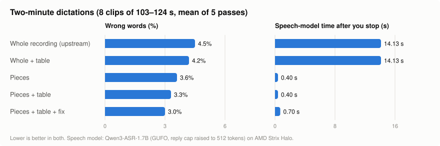
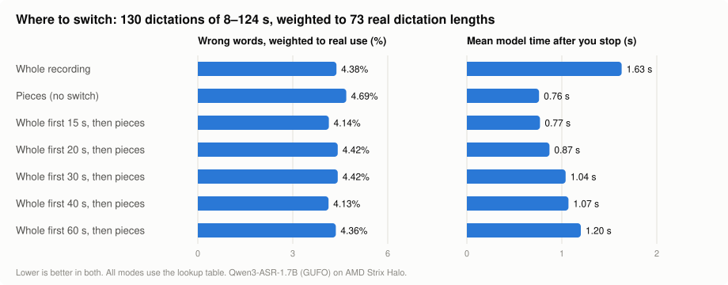

# Hermes fork: faster dictation on a self-hosted Diction gateway

Branch `hermes/live-text`, based on upstream `release/v15.0`.
Upstream discussion: [DictionLabs/Diction#29](https://github.com/DictionLabs/Diction/issues/29).

## What it adds

**Pieces mode** (`DICTION_SEGMENTED_FINAL=true`). Normally the gateway waits until you stop
talking, then sends the whole recording to the speech model. In pieces mode it transcribes
while you talk: at each pause it sends the piece since the last pause, so when you stop only
the last piece is left. With `DICTION_SEGMENT_FIRST_MIN_MS` the first piece is longer, so
short dictations go whole and only long ones become pieces (15 s is the measured best).

```
whole    [ you talk ............................ ] stop → [ transcribe everything ] → text
pieces   [ you talk ...... | pause ...... | .... ] stop → [ last piece ] → text
```

**Live text** (`DICTION_PREVIEW=chunked`): draft words while you speak, for apps that ask
(`?preview=cloud`). **We do not have the Diction app's source; the keyboard showing live text
waits for the app makers' update** (issue #29, TestFlight).

Both are off by default. If anything fails mid-way, the gateway sends the whole recording
exactly as upstream does, so a dictation is never lost.

## Pieces, live text and true streaming are three different things

| | Pieces (ours, live now) | Live text (the app maker's plan) | True streaming |
|---|---|---|---|
| What it changes | how soon the **final** text is ready | what you **see while you talk** | how the **model** listens |
| While you talk | nothing on screen | a draft about once a second, replaced each time | words appear as they are spoken |
| After you stop | 0.4–0.8 s, any length | final as today (whole recording, or our pieces) | almost nothing left to do |
| Needs an app change | no | yes: today's app reads one frame, after `done` | yes, same as live text |
| Needs the model to stream | no | no | yes |

```
pieces      talk ...... | pause ...... | pause ....  stop → last piece → final
live text   talk ......................................  stop → final
            draft ↑ draft ↑ draft ↑ draft ↑ (each the whole transcript so far)
streaming   talk ......................................  stop → final
            word word word word word word word word ... (the model decodes as audio arrives)
```

They combine: drafts on screen while you talk, pieces for a fast final.

**Can Qwen3-ASR on GUFO stream for real? No.** Tested 2026-11-09 with
`hermes/bench/rt_probe.py`, a 26 s clip played at real-time pace:

- `/v1/realtime` (OpenAI-style WebSocket) accepts audio but sends nothing until
  `input_audio_buffer.commit`. It then transcribes the whole buffer at once and streams the
  words out (first word 0.3 s after commit).
- Committing every 2 s gives a result 0.2–0.3 s after each commit, but each commit is a
  separate item heard without context: 2–8 words each, cut wherever the 2 s lands. That is
  pieces with blind cuts, worse than cutting at pauses.
- SSE (`stream=true` on `/v1/audio/transcriptions`) streams the text out quickly, but only
  after the whole file is uploaded.

So on this model, live text means re-transcribing the open piece (since the last pause) about
once a second, which the built-in preview (`DICTION_PREVIEW=chunked`) already does: first
words at 1.1–1.4 s in the bench. Word-by-word streaming needs a streaming-native model for the
drafts, with Qwen3-ASR kept for the final. The plan is in `hermes/LIVE-TEXT-PLAN.md`.

## Short dictations: pieces are 3× faster but make nearly twice the errors

16 dictations, 5 passes each, upstream and fork taking turns (details below):

```mermaid
xychart-beta
    title "Whole recording vs pieces (16 clips, mean of 5 passes)"
    x-axis ["Wrong words (%)", "Wait after stop (s)"]
    y-axis 0 --> 11
    bar [5.7, 2.66]
    bar [10.2, 0.86]
```



| | Wrong words | Wait after you stop |
|---|---|---|
| Whole recording (upstream) | **5.7%** | 2.66 s |
| Pieces (8 s minimum) | **10.2%** | **0.86 s** |

Pieces were worse on 10 of 16 clips, better on 1, the same on 5. Each piece is transcribed
without the words around it, and the model needs that context for rare words (drug names
above all). Longer pieces (12 s, 16 s) did not fix it, and on a short piece the model
sometimes wrote out its whole hint list (the gateway now rejects a piece with more text than
its audio could hold).

**So for short dictations where accuracy matters, keep pieces off.** Two-minute dictations
are the opposite case (see below): there pieces are both faster and more accurate.

## Can pieces be rescued? Lookup tables and a confidence fix

Two add-ons, tested on the same 16 dictations × 5 passes, every combination:

- **Lookup table**, applied to the text after transcription. A word that is neither English
  nor a known term is replaced by the closest term, by spelling and by sound, when the match
  is close and unambiguous ("levitiracetam" → levetiracetam, "pixaban" → apixaban). Three sizes:
  the 50-term hint list; a 268-term library; and the library plus 26 "heard → written" rules
  learned automatically from 16 *separate* training dictations (different sentences, different
  voices), so the rules were never tuned on the test.
- **Confidence fix.** The draft from the pieces marks low-confidence words: neither English
  nor a known term (the speech model reports no per-word confidence). Each piece holding one is
  re-transcribed with the piece before and after it as context, and only the uncertain words are
  swapped for what the wider window heard. Earlier pieces are fixed while you are still
  talking; only the last two pieces wait until you stop.

| Mode | Wrong words | Terms spelled right | Model time after stop |
|---|---|---|---|
| Whole recording (upstream) | 5.7% | 79% | 1.27 s |
| Whole recording + best table | **5.4%** | 84% | 1.27 s |
| Pieces | 10.1% | 72% | **0.36 s** |
| Pieces + 50-term table | 9.5% | 76% | 0.36 s |
| Pieces + 268-term table | 9.0% | 80% | 0.36 s |
| Pieces + 268 terms + learned rules | 8.6% | 81% | 0.36 s |
| Pieces + confidence fix | 6.5% | 81% | 1.51 s |
| Pieces + 50-term table + confidence fix | 6.2% | 83% | 1.51 s |
| Pieces + 268-term table + confidence fix | 6.2% | **85%** | 1.38 s |
| Pieces + 268 terms + learned rules + confidence fix | 6.2% | **85%** | 1.29 s |

What this shows:

- **Tables alone help, but not enough:** 10.1% → 8.6% wrong words, at no cost in time (under
  2 ms; the table is indexed, so even 5,000 terms stay fast). Fill it with real terms: a table
  padded with look-alikes makes pointless swaps.
- **The confidence fix closes most of the gap:** 6.2% wrong words, against 5.7% for the whole
  recording, and the best term spelling of any mode (85%). It improved 155 clip-passes and made
  20 worse (out of 320).
- **But on these short dictations it is not faster than the whole recording.** With 17–28 s
  clips there are only 2–3 pieces, so the window re-checked after you stop is most of the
  recording. On longer dictations the picture flips: see the next section.
- **Learned rules must be curated.** Raw learning also proposed "it figures → IVIG" and "of a
  tumor → ofatumumab"; the learner now rejects any rule whose heard words are all ordinary
  English.

"Model time" is the speech model's own time, measured in one session for all modes. The
end-to-end wait adds network and gateway overhead and grows when the GPU is shared (the bench
above measured 0.86 s for pieces and 2.66 s for the whole recording under load).

Tools: `hermes/bench/fuzzyfix.py` (table), `learn_rules.py`, `sim_repair.py` (the matrix
above), `training_set.py`, `learned-rules.txt`.

## Two-minute dictations: pieces win on speed and accuracy

Long dictations are where the wait hurts: in real use the whole-recording wait grew from 4 s
(66 s of speech) to 7.4 s (81 s) to 16 s (2 min). So the same test was repeated on 8 dictations
of 103–124 s each (clinical notes, a research update, a homelab and a dev plan, weekend plans;
one has a 30 s run with no real pause, to force the 20 s maximum cut), 5 passes each.



| Mode | Wrong words | Terms spelled right | Model time after stop | End-to-end wait (median) |
|---|---|---|---|---|
| Whole recording (upstream) | 4.5% | 70% | 14.1 s | 14.2 s |
| Whole recording + best table | 4.2% | 72% | 14.1 s | |
| Pieces | 3.6% | 73% | **0.40 s** | **0.40 s** |
| Pieces + 50-term table | 3.4% | 76% | 0.40 s | |
| Pieces + 268-term table (± learned rules) | 3.3% | 78% | 0.40 s | |
| Pieces + confidence fix | 3.0% | **80%** | 0.70 s | |
| Pieces + 50-term table + confidence fix | **2.9%** | **80%** | 0.70 s | |
| Pieces + 268-term table + confidence fix | 3.0% | 79% | 0.70 s | |

- **Pieces are 35× faster** (0.4 s against 14 s, end to end, median of 40 dictations each;
  pieces' slowest was 3.8 s, the whole recording's fastest 13.3 s).
- **And more accurate, not less**: 3.6% wrong words against 4.5%. Pieces were better on 4 of 8
  clips, the same on 3, worse on 1. On a long recording the model drifts; on 8–20 s pieces it
  stays on track. This is the opposite of the short-dictation result, where pieces lose the
  context they need.
- **The table helps a little at no cost** (3.6% → 3.3%), the confidence fix a little more
  (→ 2.9–3.0%, terms 73% → 80%) for 0.3 s. Every pieces variant beats the whole recording.
- Caveat: the confidence fix's model time assumes the re-checks of earlier pieces (about 3 per
  dictation, ~60 s windows) finish while you are still talking. On a single GPU they queue
  behind the pieces themselves; that is not modelled. Pieces alone and pieces + table were
  measured end to end.

**The speech model was cutting long dictations short.** GUFO caps each transcription reply
at about 256 tokens unless the request asks for more. Every two-minute whole recording came back
cut mid-sentence after 174–225 of 230–297 words (27% "wrong words", nearly all of it missing
text); pieces never hit the cap. Asking for `max_tokens=512` (GUFO's maximum) returns the whole
text for about 2 s more model time; the whole-recording numbers above are with that fix. 512
tokens is roughly 3 minutes of speech, so a longer whole recording is still cut; pieces are not.
If you serve Qwen3-ASR through GUFO, send `max_tokens` with every transcription request.

Tools: `hermes/bench/long_set.py` (scripts), `make_clips.py ... long`, and the same `bench.sh`,
`sim_repair.py` as above.

## Where to switch: whole for the first 15 s, then pieces

Short dictations are more accurate whole, long ones are faster and more accurate in pieces.
So the gateway can now make the **first piece at least T seconds long**
(`DICTION_SEGMENT_FIRST_MIN_MS`): a dictation shorter than T goes whole, a longer one becomes
pieces after T. Which T?

**Test.** All 24 test dictations (16 short, 8 two-minute) were also cut short at each natural
pause, giving 130 dictations of 8–124 s. Each was transcribed whole, as plain pieces, and with
T = 15, 20, 25, 30, 40 and 60 s; every mode through the lookup table. Cuts come from a Python
port of the gateway's pause detector, which reproduces the gateway's logged cuts to 0.01 s. The
results are weighted by the lengths of 73 real dictations from the gateway's debug log (64%
under 15 s, 15% 15–25 s, 12% 25–40 s, 8% longer).



| Length | Whole | Pieces (no switch) | Whole first 15 s | Whole first 20 s |
|---|---|---|---|---|
| 15–25 s (27 dictations) | 5.3% · 1.53 s | 6.5% · 0.78 s | 6.0% · 0.82 s | 5.2% · 1.43 s |
| 25–40 s (17) | 5.2% · 2.11 s | 6.3% · 0.66 s | **4.7% · 0.72 s** | 5.7% · 0.74 s |
| 40–60 s (15) | 3.3% · 4.64 s | 3.3% · 0.81 s | **2.9% · 0.73 s** | 3.7% · 0.85 s |
| 60–90 s (22) | 3.7% · 7.82 s | 3.4% · 0.80 s | **3.1% · 0.84 s** | 3.6% · 0.82 s |
| 90–130 s (28) | 4.4% · 14.5 s | 3.6% · 0.60 s | **3.2% · 0.60 s** | 3.6% · 0.60 s |

(wrong words · speech-model time after you stop; under 15 s every mode is the whole recording)

**The arithmetic.**

- *Speed.* The whole-recording wait fits `0.67 + 0.017·L + 0.00103·L²` seconds for L seconds of
  speech: it passes 1 s at about 12 s of speech and 2 s at about 29 s, and keeps growing with
  the square of the length. Pieces stay at 0.6–0.8 s whatever the length.
- *Accuracy.* Plain pieces cost `3.89 − 0.99·ln(L)` wrong-word points against the whole
  recording: +1.2 points at 15 s, +0.5 at 30 s, zero at **about 51 s** (80% interval 29–95 s,
  bootstrap over clips). The cost comes from a short first piece that the model hears without
  context.
- *A 15 s first piece removes most of that cost.* Over the real length mix, whole-first-15-s
  makes **4.14%** wrong words against 4.38% for the whole recording and 4.69% for plain pieces,
  with a mean wait of **0.77 s** (whole: 1.63 s; worst length band 0.84 s against 14.5 s). It
  is the most accurate and nearly the fastest option, so no trade-off weight is needed: every
  later switch point is slower and no more accurate (T = 40 s ties on accuracy at 1.07 s).
- The differences in accuracy are small and the intervals are wide: 15 s vs whole is −0.8
  points (90% interval −1.6 to +0.2). On the 16 short, term-dense dictations alone, 15 s is
  still 1.1 points worse than whole (20 s: 0.5 worse, not significant), because a 17–28 s
  dictation leaves a short last piece. The speed gain is not in doubt.

**Chosen: 15 s.** Live since 2026-11-09 with the lookup table and `max_tokens=512`: in a
real-time check the two-minute dictations came back in 0.4–0.6 s with the full text, a 26 s one
in 0.75 s, a 19 s one (whole) in 1.3 s. Note: the minimum is checked when the pause qualifies
and the cut goes in the middle of the pause, so the first cut can land a few tenths of a
second before T (the simulation does the same).

Tools: `hermes/bench/sim_switch.py` (sweep), `analyze_switch.py` (bands, fits, real-mix
weighting).

## Live trial (from 2026-11-09, a few weeks of everyday use)

**What runs.** Diction gateway `hermes-5` with `DICTION_SEGMENTED_FINAL=true`,
`DICTION_SEGMENT_FIRST_MIN_MS=15000` and `DICTION_DEBUG_STREAM=true` (timings only); speech
gateway with the 268-term lookup table and `max_tokens=512`. No confidence fix. Rollback is
one line each: the previous container files are kept beside the live ones (whole recording,
speech gateway without the reply-cap fix).

**Baseline from real use.** 72 dictations on the phone with the whole recording, the day
before the switch (wait = from "stop" to text in the app's field, measured by the gateway):

| Length | Dictations | Median wait | 90th percentile | Worst |
|---|---|---|---|---|
| under 15 s | 47 | 0.70 s | 1.73 s | 7.0 s |
| 15–25 s | 11 | 1.39 s | 4.61 s | 5.0 s |
| 25–40 s | 9 | 2.35 s | 4.19 s | 4.7 s |
| 40–90 s | 4 | 3.8–5.7 s | | 7.4 s |
| over 90 s | 1 | 16.3 s | | 16.3 s |

All 72: median 0.96 s, mean 1.77 s. Fit: `0.73 + 0.032·L + 0.00073·L²` s, close to the
bench fit above.

**What is tracked.** `hermes/trial/collect.sh` copies the gateways' metric lines out of the
journal into a private file on the server (only lengths, timings, piece counts, character
counts and how many lookup-table swaps, without the words; never text, audio or keys), every 6 hours from a user timer
(`hermes/trial/diction-trial.timer`). `hermes/bench/assess_live.py` turns it into: wait by length band
against the baseline, time saved against the baseline fit, how dictations were served (whole
under 15 s, pieces, fallback), piece failures and backend errors, table swaps, and characters
per second of speech as a rough check that pieces do not drop words.

**How it will be judged (set before the trial).**

- *Speed:* median wait under 1 s for dictations of 25 s and more (baseline 2.3–16 s), and the
  90th percentile over all dictations below the baseline's 4.2 s.
- *Reliability:* piece failures plus fallbacks to whole under 2% of piece dictations; no rise
  in backend errors.
- *Completeness:* characters per second for pieces within about 10% of the baseline in the
  same length band (the long-dictation baseline was made before the reply-cap fix, so very
  long dictations may read higher now).
- *Accuracy:* the log has no reference text, so wrong words are judged by the owner's use,
  plus a re-run of the standard bench set at the end to catch model drift.
- *Not counted:* dictations of 16 s or more that never pause after 15 s stay whole by design.

## Settings (environment variables, all off by default)

| Variable | Default | Meaning |
|---|---|---|
| `DICTION_SEGMENTED_FINAL` | `false` | Pieces mode (fast, less accurate). |
| `DICTION_PREVIEW` | `off` | `chunked` turns on live text for apps that ask. |
| `DICTION_SEGMENT_PAUSE_MS` / `_MIN_MS` / `_MAX_MS` | 700 / 8000 / 20000 | Where pieces are cut. |
| `DICTION_SEGMENT_FIRST_MIN_MS` | `0` (= `_MIN_MS`) | First piece at least this long: shorter dictations go whole. 15000 recommended. |
| `DICTION_PREVIEW_URL` / `_MODEL` | session backend | Optional faster backend for live text. |
| `DICTION_DEBUG_STREAM` | `false` | Log timings per dictation (never audio, text or keys). Needed for `hermes/trial/`. |

## How the test was done (reproducible)

**Input voice.** Each clip is synthesized sentence by sentence with Qwen3-TTS
(`Qwen3-TTS-12Hz-1.7B-CustomVoice`), voices `aiden` and `serena` alternating, 24 kHz. Fragments
are joined with set pauses (0.8–1.3 s; two clips pause mid-sentence), plus 0.4 s of silence
before and 0.5 s after, and a quiet-room noise floor (Gaussian, -50 dBFS, seeded per clip).
The result is resampled to 16 kHz mono and encoded the way the app sends it: Ogg/Opus,
16 kb/s, VoIP mode, 200 ms pages. Scripts, pauses and target terms are in
`hermes/bench/standard_set.py`; the exact audio measured is in `hermes/bench/standard/`
(TTS output varies run to run). Terms are drawn from a typical hint list, from a larger
term library, and from neither; all names are fictional.

**Measurement.** `hermes/streamclient` plays a clip like the app: each Ogg page at the moment
it would have been recorded, "done" right after the last one, timing "done" → final text.
`hermes/bench/bench.sh` runs upstream and the fork as two containers taking turns on each
clip, 5 passes, so anything else using the GPU slows both alike. Speech model: Qwen3-ASR-1.7B
behind a small gateway that adds a hint list, corrections and filler removal (the same for
both). Wrong words: word error count against the script, ignoring case and punctuation.

```sh
python3 hermes/bench/make_clips.py my-clips http://127.0.0.1:PORT/v1/audio/speech standard
(cd hermes/streamclient && go build .)
BACKEND_URL=http://127.0.0.1:PORT BACKEND_MODEL=MODEL PREVIEW=0 LABEL=pieces8 \
  sh hermes/bench/bench.sh UPSTREAM_IMAGE FORK_IMAGE hermes/bench/standard out.jsonl 5
python3 hermes/bench/pairs.py out.jsonl hermes/bench/standard
python3 hermes/bench/eval_fix.py out.jsonl hermes/bench/standard HINTS.txt LIBRARY.txt
```

An earlier 4-clip test (`hermes/bench/clips/`) showed the same speed-up but hid most of the
accuracy cost; it took the 16-clip set to see it.
